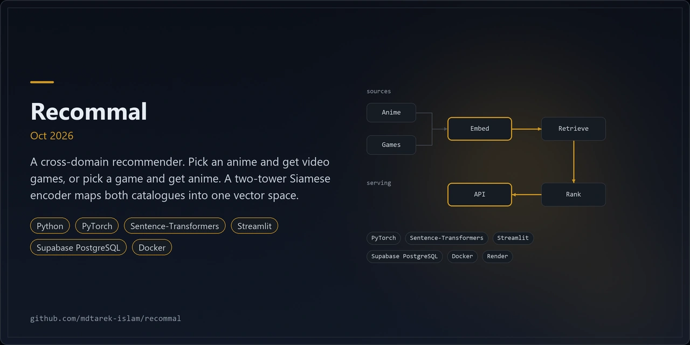
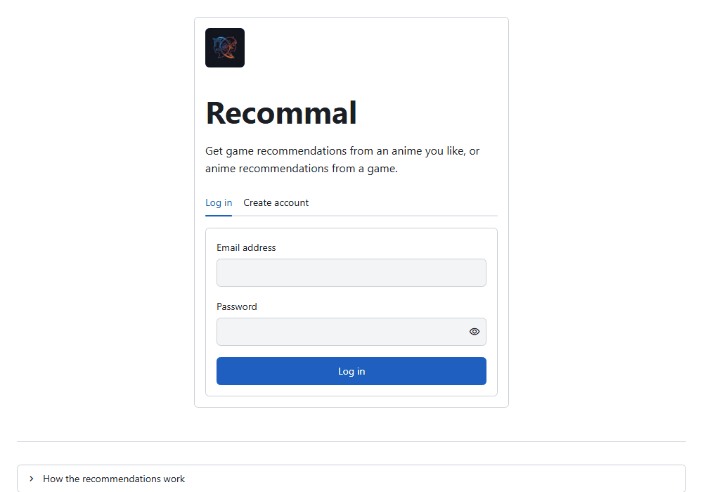
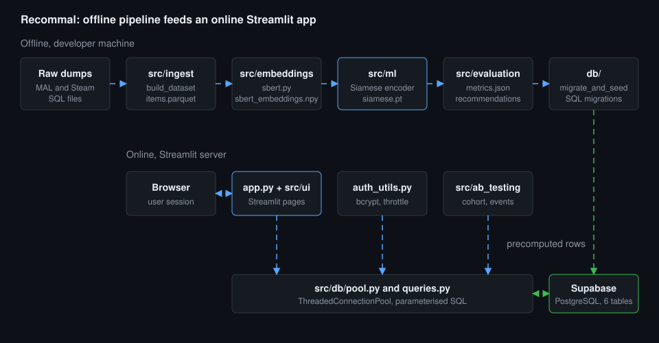
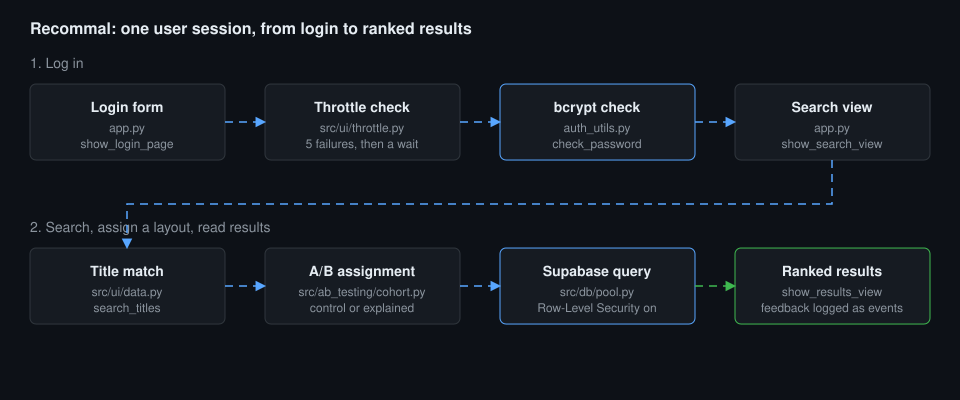
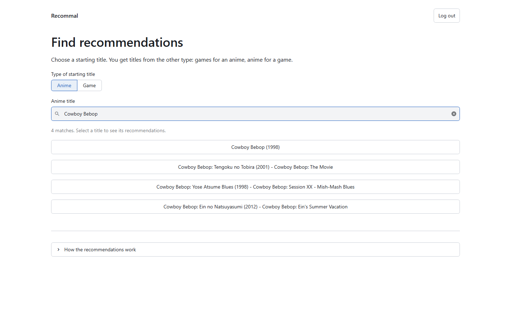
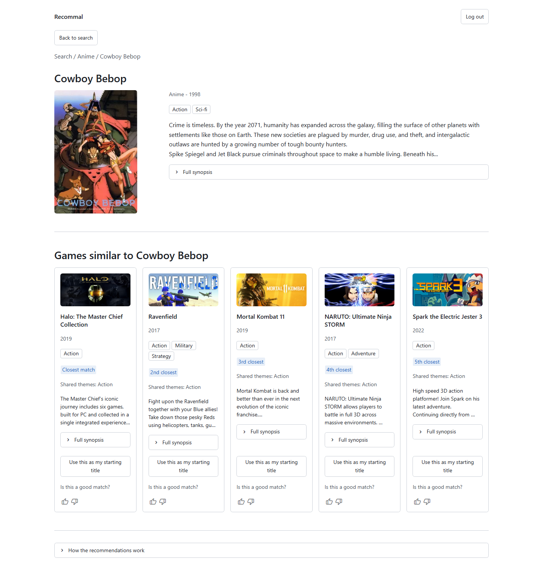
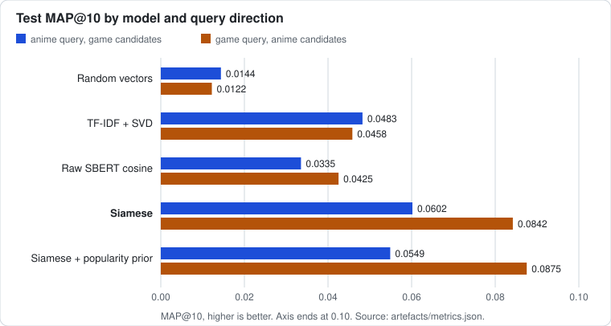

<p align="center"></p>

<div align="center">

# Recommal

**A cross-domain recommender. Pick an anime and get video games. Pick a game and get anime.**

[](https://github.com/mdtarek-islam/recommal/actions/workflows/ci.yml)




</div>

## Overview

Anime catalogues and game catalogues use different vocabularies. MyAnimeList genres describe themes. Steam genres describe gameplay.
Recommal maps both domains into one shared vector space from a title and a synopsis. It uses no user interaction history.
Cosine similarity in that space ranks candidates from the other domain.

| Layer | Technology |
|---|---|
| App | Streamlit (`app.py`, `src/ui`) |
| Embeddings | `sentence-transformers/all-MiniLM-L6-v2`, 384 dimensions |
| Model | Two-tower Siamese encoder in PyTorch, 128-dimension output |
| Storage | Supabase PostgreSQL with Row-Level Security |
| Auth | bcrypt hashes, session and server-side login throttling |
| Hosting | Docker image on Render (`Dockerfile`, `render.yaml`) |

## Architecture



1. **Ingest.** `src/ingest` parses the MAL and Steam SQL dumps, cleans text and builds a 23-theme taxonomy (`src/ingest/themes.py`).
2. **Embeddings.** `src/embeddings/sbert.py` encodes each title and synopsis into a 384-dimension vector.
3. **Model.** `src/ml` trains a shared-weight Siamese encoder with a contrastive loss (margin 0.5). A pair is relevant at theme Jaccard 0.5 or more.
4. **Evaluation and export.** `src/evaluation` writes `artefacts/metrics.json` and the ranked `recommendations.parquet`.
5. **Seed.** `db/migrate_and_seed.py` applies the SQL migrations and loads the precomputed rows into Supabase.
6. **Online app.** `app.py` serves search and results. `auth_utils.py` handles login. `src/ab_testing` assigns a layout. `src/db/pool.py` pools connections.

The ML pipeline runs offline on a developer machine. Only precomputed rows reach the database.



A session passes login throttling and a bcrypt check, then a title search, an A/B assignment and a Supabase query under Row-Level Security.

## Features

- Cross-domain search in both directions: anime to games, games to anime.
- Case-insensitive title search over trigram indexes.
- A/B test with two layouts. `control` ranks by latent similarity. `explained` adds a popularity prior and the shared themes.
- Thumbs up or down feedback, logged as events.
- URL routing: the domain and title id live in the URL, so refresh, Back and shared links reopen the same view.
- Registration and login with bcrypt hashes and login throttling.

| Desktop search | Explained layout |
|---|---|
|  |  |

### Engineering findings

Tests: the full suite passes 186 tests across 12 files (9 unit, 2 UI, 1 end-to-end), 0 skipped, run on 2026-11-02.

Source: `artefacts/metrics.json` (model `siamese-v2`, seed 42, test split, K = 10, relevance is theme Jaccard 0.5 or more). The `artefacts/` folder stays out of git. Run `python -m src.evaluation.evaluate` to recreate it.

| Model | MAP@10 anime to game | MAP@10 game to anime | Mean MAP@10 | Mean P@10 | Mean Recall@10 |
|---|---|---|---|---|---|
| Random vectors | 0.0144 | 0.0122 | 0.0133 | 0.0348 | 0.0025 |
| TF-IDF + SVD | 0.0483 | 0.0458 | 0.0470 | 0.0921 | 0.0130 |
| Raw SBERT cosine | 0.0335 | 0.0425 | 0.0380 | 0.0820 | 0.0112 |
| Siamese | 0.0602 | 0.0842 | 0.0722 | 0.1358 | 0.0189 |
| Siamese + popularity prior | 0.0549 | 0.0875 | 0.0712 | 0.1317 | 0.0168 |

- The base rate of a relevant candidate is 0.0357 (anime to game) and 0.0349 (game to anime). Test contrastive loss is 0.0575 on 154536 pairs.
- The Siamese model beats every baseline, but absolute scores are low. The project MAP@10 target of 0.82 is not met.
- Masking lexicon keywords in test games drops the Siamese mean MAP@10 by 0.0086 and the raw SBERT score by 0.0041. The model uses some keywords.
- The run without hard negatives scores 0.1027 on test, above the selected model. Selection used the validation split.
- Seed spread: Siamese over 3 training seeds scores 0.0766 with a standard deviation of 0.0045. Random vectors over 5 seeds score 0.0131 with 0.0005.
- Labels are weak: genres plus a keyword lexicon. Offline MAP@10 on weak labels does not show that users like the lists.
- The `explained` layout changes ranking and explanation together, so the A/B test cannot separate them. There is no user study.



Grouped bars of test MAP@10 per model and direction, drawn from `artefacts/metrics.json`.


The full method, splits and threats to validity are in [docs/methodology.md](docs/methodology.md). The review of the original dissertation pipeline is in [docs/dissertation-critique.md](docs/dissertation-critique.md).

## Quick start

Requirements: Python 3.13 and a Supabase project. The free tier is enough for the app.

```
git clone https://github.com/mdtarek-islam/recommal.git
cd recommal
python -m venv .venv
source .venv/Scripts/activate      # Git Bash on Windows. Use .venv\Scripts\activate in cmd or PowerShell
pip install -r requirements.txt
```

Create the schema, load development fixtures and start the app.

```
python -m db.migrate_and_seed --migrate-only
python -m db.migrate_and_seed --fixtures
streamlit run app.py
```

For the pipeline, tests and linting, install the CPU build of PyTorch first, then the development set.

```
pip install torch --index-url https://download.pytorch.org/whl/cpu
pip install -r requirements-dev.txt
```

## Configuration

Set these in the environment or in a `.env` file at the repository root. Never commit `.env`. The pool also reads `RECOMMAL_ENV_FILE` to find a different file.

| Variable | Purpose |
|---|---|
| `DB_HOST`, `DB_PORT`, `DB_NAME`, `DB_USER`, `DB_PASSWORD` | Supabase session pooler connection |
| `RECOMMAL_AB_SALT` | Secret key for the A/B pseudonyms. Without it the app logs a warning and uses a public development key |
| `RECOMMAL_RAW_DIR` | Pipeline only. Folder that holds `sql/animes_db.sql` and `sql/steam_games.sql`. Default `data/raw` |

Generate a salt with `python -c "import secrets; print(secrets.token_urlsafe(48))"`. Streamlit settings sit in `.streamlit/config.toml`.

## Usage

Run the pipeline stages in order. Each stage reads the output of the stage before it.

```
python -m src.ingest.build_dataset
python -m src.embeddings.sbert
python -m src.ml.train
python -m src.evaluation.evaluate
python -m src.evaluation.recommend
python -m db.migrate_and_seed
python scripts/make_diagrams.py
```

`db.migrate_and_seed` without flags loads the real recommendations. `scripts/make_diagrams.py` rebuilds the result table and charts under `docs/assets`.

Run the checks that CI runs (`.github/workflows/ci.yml`).

```
pytest -q --ignore=tests/e2e
ruff check .
mypy
```

The browser smoke test needs Playwright: `pytest -q tests/e2e`.

Deploy with Docker on Render: the blueprint is `render.yaml`. Streamlit needs a persistent WebSocket, so it cannot run on Vercel. The free service sleeps after about 15 minutes idle and has 512 MB of RAM. Steps and DNS notes are in [docs/deployment.md](docs/deployment.md).

Security controls in the code:

- RLS is on for every table. The REST API reads the catalogue and recommendations only. Migration 002 revokes default Supabase grants on future objects.
- The app stores bcrypt hashes and rejects passwords above 72 bytes.
- The session throttle allows 5 failures, then waits 30 seconds, doubling up to 900 seconds. The `login_attempts` table limits 5 failures in 15 minutes.
- Telemetry stores an HMAC-SHA256 pseudonym, never an email address. SQL uses `%s` placeholders. The UI shows fixed error messages.

## Licence and contribution

Released under the MIT licence. See [LICENSE](./LICENSE). Raise bugs and suggestions as issues at https://github.com/mdtarek-islam/recommal/issues. Run `ruff check .`, `mypy` and `pytest` before you open a pull request.

Data and models: MyAnimeList data follows the MyAnimeList terms. Steam data follows the Steam terms. The sentence encoder is [`sentence-transformers/all-MiniLM-L6-v2`](https://huggingface.co/sentence-transformers/all-MiniLM-L6-v2). The loss follows Hadsell, Chopra and LeCun (2006), "Dimensionality reduction by learning an invariant mapping".

## Maintenance status

**Maintained.** The repository has 17 commits between 2026-10-21 and 2026-10-23, and the latest is dated 2026-10-23. It has no commits since.
